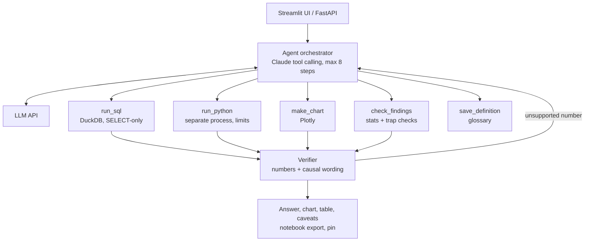

# AI Data Analyst Agent

Upload a CSV, ask a question in plain English, and get back the SQL, the Python, a chart and a short answer whose
numbers have been checked. Unlike a plain text-to-SQL bot, the agent **thinks like an analyst**: it checks data quality
on upload, runs significance tests before claiming a difference, catches Simpson's paradox and outlier-driven averages,
learns your metric definitions, and exports every answer as a notebook that re-runs end to end.


## Home page

The app opens on a ginger-tabby themed home page (`ui/home_component/`): a pixel-font hero with an animated
scanline cat ("Whiskers"), and a shelf of three folders. Hover a folder and its sample questions float out; click
one and the agent runs it on the sample data. The folders are a plain-JavaScript port of the
[FolderFloat](https://reactbits.dev) component from React Bits, with cat-ear tabs, tabby-striped flaps, keyboard
support and tap-to-open on touch screens. The page talks to Streamlit through the custom-component message
protocol, so no React build step is needed.

## What makes it different

| Feature | What it does |
| --- | --- |
| **Data-quality report on upload** | Flags duplicate rows, mixed date formats in one column, near-duplicate category spellings (`Delhi` / `Dehli` / `delhi `), mostly-empty and constant columns, before the first question. |
| **Trap detection** | Before an answer goes out: Simpson's paradox (a gap that reverses inside every subgroup), averages driven by a few extreme rows, groups too small to compare, and cause-and-effect wording drawn from correlation alone. Runs automatically even if the model forgets to ask. |
| **Significance first** | `check_findings` runs Welch's t-test, ANOVA or chi-square (with effect sizes) before the agent says "X is higher than Y". |
| **Number verifier** | Every number in the final answer must trace back to a tool output. If one doesn't, the agent is sent back once to recompute it. |
| **Learns from corrections** | Say "revenue should exclude refunds" and it saves a glossary definition (SQLite) that is applied to every later question. |
| **Reusable outputs** | Download any answer as a runnable `.ipynb`; pin it to a dashboard that re-runs the query on refresh. |

## How it works



The loop is hand-written (`analyst_agent/agent/loop.py`, ~250 lines) rather than a framework, so every step is visible
and testable. A `ScriptedLLM` replays fixed tool calls, which lets the whole pipeline be tested without an API key.

## Quick start (VS Code, Windows)

```powershell
git clone https://github.com/meghap-27/Data-Analyst-Agent
cd data-analyst-agent
python -m venv .venv
.venv\Scripts\activate          # macOS/Linux: source .venv/bin/activate
pip install -r requirements.txt
copy .env.example .env          # then paste your Anthropic API key into .env
streamlit run ui/streamlit_app.py
```

In VS Code you can also use **Run and Debug** → *Streamlit app* / *FastAPI backend* (see `.vscode/launch.json`).

**No API key?** Click **Use sample retail dataset**, then **Offline demo**. It replays a scripted run that walks into
the Simpson's paradox planted in the sample data.

## Sample data

`sample_data/retail_orders.csv` (3,025 rows, regenerate with `python sample_data/make_sample.py`) has deliberate traps:

- Store orders average more than Online overall, but **Online is higher in every region** (Simpson's paradox).
- 8 bulk B2B orders make the mean order value about 2x the median.
- Mixed date formats, misspelled cities, 25 duplicate rows, and refunds that make "revenue" ambiguous.

## API

```bash
uvicorn analyst_agent.api:app --reload      # docs at http://localhost:8000/docs
```

| Method | Path | Purpose |
| --- | --- | --- |
| POST | `/sessions` | New session |
| POST | `/sessions/{id}/upload` | Upload CSV/Excel → profile + quality report |
| POST | `/sessions/{id}/ask` | Ask a question; streams progress as Server-Sent Events |
| GET | `/sessions/{id}/runs/{run}/notebook` | Download the answer as `.ipynb` |
| GET/POST/DELETE | `/glossary` | Business definitions |
| GET/POST/DELETE | `/pins`, `/pins/{id}/refresh` | Dashboard pins |

## Tests and evaluation

```bash
pytest -q                          # 36 tests, no API key needed
python evals/run_eval.py           # benchmark with the real model (needs API key)
```

`evals/questions.jsonl` covers lookups, aggregation, time series, data-quality cases, statistics, unanswerable
questions and the three traps. Each run prints accuracy by category and saves results to `evals/results/`.

| Category | Accuracy |
| --- | --- |
| _run `python evals/run_eval.py` and paste the table here_ | |

## Project layout

```
analyst_agent/
  agent/        loop.py (orchestrator), llm.py (Claude + scripted fake), prompts.py (system prompt, tool schemas)
  analyst/      stats.py (significance tests), traps.py (paradox, outliers, small n), verify.py (number checker)
  data/         store.py (sessions, DuckDB), profile.py (profiling + data-quality report)
  tools/        sql.py (guarded SQL), python_exec.py + _runner.py (sandboxed code), chart.py
  export/       notebook.py
  glossary.py, pins.py, api.py, demo.py, config.py
ui/streamlit_app.py
ui/home_component/   home page: hero + FolderFloat shelf (HTML/JS, bundled matter-js)
.streamlit/config.toml   cat-palette theme
evals/  sample_data/  tests/
```

## Safety

- SQL is parsed with sqlglot and must be a single `SELECT`; DuckDB file access is disabled and locked for the session.
- Python runs in a separate `python -I` process with CPU, memory and time limits and an empty environment (no API
  keys). **It does not block network access yet.** Before a public deploy, run it in a Docker container with
  `--network none` or a hosted sandbox (E2B, Modal).
- Data samples are sent to the LLM provider; don't upload data you can't share.

## Roadmap

- [ ] Docker sandbox with network disabled; Docker Compose deploy
- [ ] Connect Postgres/MySQL read-only
- [ ] Scheduled weekly reports from pinned answers
- [ ] Run the eval set on 2-3 models and publish the comparison

## Credits

- FolderFloat design: [React Bits](https://reactbits.dev), ported to vanilla JS.
- Physics: [matter-js](https://brm.io/matter-js/) (MIT), bundled in `ui/home_component/matter.min.js`.

Built by [Megha](https://github.com/meghap-27).
