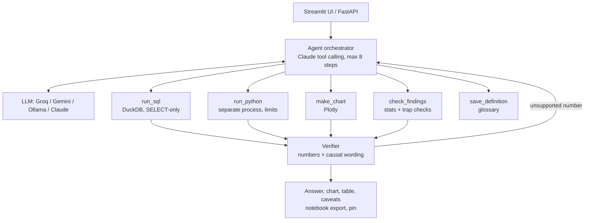

# AI Data Analyst Agent

Upload a CSV, ask a question in plain English, and get back the SQL, the Python, a chart and a short answer whose
numbers have been checked. Unlike a plain text-to-SQL bot, the agent **thinks like an analyst**: it checks data quality
on upload, runs significance tests before claiming a difference, catches Simpson's paradox and outlier-driven averages,
learns your metric definitions, and exports every answer as a notebook that re-runs end to end.


## Design

The look is a cat on an analyst's desk: a cardboard surface, answers on sheets of paper, dark-brown ink, a ginger
cat, and graph-paper blue for links and charts. Type is Atkinson Hyperlegible (chosen for reading numbers) with
Silkscreen for the wordmark; both are bundled in `ui/static/fonts` (SIL Open Font License), so no request goes
to Google.

The 3D is kept to two places. On the home page the sheet tilts toward the pointer, the extruded wordmark's shadow
moves with the light, and the scanline cat turns: each scanline shifts by how far that part of the body bulges
toward you, so the head and belly rotate as shapes; its eyes follow the pointer. Below it, three folders stand on
the desk in perspective, lean toward the pointer and lift when hovered. Their questions are written for whatever
file you uploaded (`analyst_agent/suggest.py`, built from its columns and data-quality report, no AI call). The
folders are a plain-JavaScript port of [FolderFloat](https://reactbits.dev) from React Bits. Reduced-motion
settings turn the movement off.

## What makes it different

| Feature | What it does |
| --- | --- |
| **Data-quality report on upload** | Flags duplicate rows, mixed date formats in one column, near-duplicate category spellings (`Delhi` / `Dehli` / `delhi `), mostly-empty and constant columns, before the first question. |
| **Trap detection** | Before an answer goes out: Simpson's paradox (a gap that reverses inside every subgroup), averages driven by a few extreme rows, groups too small to compare, and cause-and-effect wording drawn from correlation alone. Runs automatically even if the model forgets to ask. |
| **Significance first** | `check_findings` runs Welch's t-test, ANOVA or chi-square (with effect sizes) before the agent says "X is higher than Y". |
| **Number verifier** | Every number in the final answer must trace back to a tool output. If one doesn't, the agent is sent back once to recompute it. |
| **Runs free** | Works on Groq, Gemini or a local Ollama model (all free), or Claude. |
| **Learns from corrections** | Say "revenue should exclude refunds" and it saves a glossary definition (SQLite) that is applied to every later question. |
| **Reusable outputs** | Download any answer as a runnable `.ipynb`; pin it to a dashboard that re-runs the query on refresh. |

## How it works



The loop is hand-written (`analyst_agent/agent/loop.py`, ~250 lines) rather than a framework, so every step is visible
and testable. A `ScriptedLLM` replays fixed tool calls, which lets the whole pipeline be tested without an API key.

## Try it in the browser (no install)

[](https://codespaces.new/meghap-27/Data-Analyst-Agent?quickstart=1)

Click the badge: GitHub builds a cloud machine, installs everything and opens the app in a new browser tab
(about 2 minutes the first time). Add your Groq key when asked, or under Settings > Codespaces > Secrets as
`GROQ_API_KEY`. Each run uses the latest code on `main`.

## Quick start (VS Code, Windows)

```powershell
git clone https://github.com/meghap-27/Data-Analyst-Agent
cd data-analyst-agent
python -m venv .venv
.venv\Scripts\activate          # macOS/Linux: source .venv/bin/activate
pip install -r requirements-dev.txt
copy .env.example .env          # then paste a free Groq key into .env (see below)
streamlit run ui/streamlit_app.py
```

### Free AI providers

The agent works with any of these; pick one in the sidebar or with `LLM_PROVIDER` in `.env`.

| Provider | Cost | Get a key | Default model |
| --- | --- | --- | --- |
| **Groq** (recommended) | Free tier, no card, rate-limited | [console.groq.com/keys](https://console.groq.com/keys) | `openai/gpt-oss-120b` |
| **Google Gemini** | Free tier, rate-limited | [aistudio.google.com/apikey](https://aistudio.google.com/apikey) | `gemini-3.8-flash` |
| **Ollama** | Free, runs on your computer, offline | install [ollama.com](https://ollama.com), then `ollama pull qwen2.5:7b` | `qwen2.5:7b` |
| Claude | Paid API credits | [platform.claude.com](https://platform.claude.com/settings/keys) | `claude-sonnet-5-5` |

Groq, Gemini and Ollama all speak the OpenAI Chat Completions format, so one adapter
(`OpenAICompatLLM`) covers them; it retries free-tier rate limits automatically. Free-tier limits change, so check
each provider's console for current numbers.

In VS Code you can also use **Run and Debug** → *Streamlit app* / *FastAPI backend* (see `.vscode/launch.json`).

**No key at all?** Click **Use sample retail dataset**, then **Offline demo**. It replays a scripted run that walks into
the Simpson's paradox planted in the sample data.

## Sample data

`sample_data/retail_orders.csv` (3,025 rows, regenerate with `python sample_data/make_sample.py`) has deliberate traps:

- Store orders average more than Online overall, but **Online is higher in every region** (Simpson's paradox).
- 8 bulk B2B orders make the mean order value about 2x the median.
- Mixed date formats, misspelled cities, 25 duplicate rows, and refunds that make "revenue" ambiguous.

### More practice data

`python sample_data/make_more_samples.py` builds two more files to upload:

| File | Rows | Traps inside |
| --- | --- | --- |
| `student_performance.csv` | 1,215 | Tutored students score lower overall but higher in every school (Simpson's paradox); city spelled several ways; day-first and ISO dates mixed; 15 duplicates; impossible study hours |
| `saas_subscriptions.xlsx` | 900 | ~10 Enterprise customers hold over 40% of revenue; support tickets correlate with churn; 34% blank NPS; inconsistent country names |

## API

```bash
uvicorn analyst_agent.api:app --reload      # docs at http://localhost:8000/docs
```

| Method | Path | Purpose |
| --- | --- | --- |
| POST | `/sessions` | New session |
| POST | `/sessions/{id}/upload` | Upload CSV/Excel → profile + quality report |
| POST | `/sessions/{id}/ask` | Ask a question; streams progress as Server-Sent Events |
| GET | `/sessions/{id}/runs/{run}/notebook` | Download the answer as `.ipynb` |
| GET/POST/DELETE | `/glossary` | Business definitions |
| GET/POST/DELETE | `/pins`, `/pins/{id}/refresh` | Dashboard pins |

## Tests and evaluation

```bash
pytest -q && ruff check .          # tests (no API key needed) and lint
TEST_DATABASE_URL=postgresql://... pytest tests/test_postgres.py   # optional: storage on real Postgres
python evals/run_eval.py --provider groq   # benchmark with a real model (free Groq key)
```

`evals/questions.jsonl` covers lookups, aggregation, time series, data-quality cases, statistics, unanswerable
questions and the three traps. Each run prints accuracy by category and saves results to `evals/results/`.

| Category | Accuracy |
| --- | --- |
| _run `python evals/run_eval.py` and paste the table here_ | |

## Project layout

```
analyst_agent/
  agent/        loop.py (orchestrator), llm.py (Claude + scripted fake), prompts.py (system prompt, tool schemas)
  analyst/      stats.py (significance tests), traps.py (paradox, outliers, small n), verify.py (number checker)
  data/         store.py (sessions, DuckDB), profile.py (profiling + data-quality report)
  tools/        sql.py (guarded SQL), python_exec.py + _runner.py (sandboxed code), chart.py
  export/       notebook.py
  glossary.py, pins.py, api.py, demo.py, config.py
ui/streamlit_app.py
ui/home_component/   home page: 3D hero + FolderFloat shelf (HTML/JS, bundled matter-js and fonts)
ui/static/           fonts and avatars served by Streamlit
.streamlit/config.toml   theme (desk palette, fonts, hidden toolbar)
evals/  sample_data/  tests/
```

## Safety and production settings

- **SQL**: parsed with sqlglot, single `SELECT` only; DuckDB file access is disabled and locked, with a memory
  limit and 2 threads per session.
- **Python**: AI-written code is checked before it runs (`tools/code_guard.py`): imports must be on an allow-list,
  and file, network, shell and dunder access is rejected. It then runs in a separate `python -I` process with CPU,
  memory and time limits and no environment variables (so no API keys). That is still not a full sandbox, so
  **public mode turns `run_python` off** unless `E2B_API_KEY` is set. With it, every Python call runs in an
  [E2B](https://e2b.dev) Firecracker microVM (same runner script, results copied back), so AI-written code never
  touches the server, its files or its keys. E2B's free Hobby tier is a one-time credit, not a monthly allowance.
- **Uploads**: capped at `MAX_UPLOAD_MB` (20) and `MAX_ROWS` (200k); in public mode they are deleted after
  `SESSION_TTL_MIN` (2 hours). Each question has an overall `RUN_TIMEOUT_S` (120 s).
- **Shared API key**: in public mode each browser session gets `QUESTIONS_PER_HOUR` (15) and the whole app
  `DAILY_QUESTION_CAP` (300) per day; visitors can switch on "Use my own API key" to skip the limits.
  If Groq's free tier is busy and a `GEMINI_API_KEY` is set, requests fall back to Gemini automatically.
- **Per-visitor data**: in public mode the glossary and pins are scoped to the browser session, so visitors never
  see each other's definitions.
- **Storage**: SQLite files by default. Set `DATABASE_URL` to a Postgres URL (e.g. [Neon](https://neon.tech)'s
  free plan) and the glossary, pins and daily usage count move there, so they survive restarts and redeploys.
  Dropped connections (Neon pauses idle databases) reconnect automatically.
- **Logs**: one JSON line per question (tools used, status, latency, tokens, warning types) with no question text,
  SQL, answers or data. Set `SENTRY_DSN` for crash reports.
- **Privacy**: column summaries and query results are sent to the AI provider; the sidebar says so.

## Deploy (free, Streamlit Community Cloud)

1. Push this repo to GitHub (done if you cloned it from there).
2. Go to [share.streamlit.io](https://share.streamlit.io), sign in with GitHub, click **Create app**.
3. Repository `meghap-27/Data-Analyst-Agent`, branch `main`, main file `ui/streamlit_app.py`.
4. **Advanced settings**: Python 3.13. Under **Secrets**, paste `.streamlit/secrets.toml.example` with your real
   Groq key. Optional: a Gemini key (backup), a Neon `DATABASE_URL` (saved data survives restarts), an
   `E2B_API_KEY` (turns on sandboxed Python) and a Sentry DSN. Keep `PUBLIC_MODE = "true"`.
5. Click **Deploy**. Every push to `main` redeploys; CI runs lint, tests and a public-mode smoke test first.

Free-tier apps sleep after a period without visitors and have about 1 GB of memory, which is why the upload
limits above exist. Check Streamlit's current limits before relying on them.

## Roadmap

- [x] Public mode: code guard, upload/row/time limits, per-visitor data, question limits, provider fallback, logs
- [x] Isolated Python in public mode via E2B sandboxes (`E2B_API_KEY`)
- [x] Glossary, pins and usage counts in hosted Postgres via `DATABASE_URL`
- [ ] Run Python in the visitor's browser (Pyodide) for a sandbox that is free forever
- [ ] Connect Postgres/MySQL read-only
- [ ] Scheduled weekly reports from pinned answers
- [ ] Run the eval set on 2-3 models and publish the comparison

## Credits

- FolderFloat design: [React Bits](https://reactbits.dev), ported to vanilla JS.
- Physics: [matter-js](https://brm.io/matter-js/) (MIT), bundled in `ui/home_component/matter.min.js`.

Built by [Megha](https://github.com/meghap-27).
